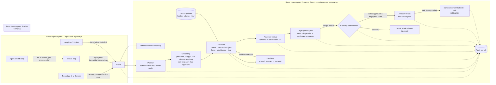

# Arsitektur Berezz

Gambar untuk submission: `docs/architecture.png` (dibuat dari `docs/architecture.html` oleh `node tools/run-cases.mjs`).

## Komponen

| Komponen | Berkas | Peran |
|---|---|---|
| UI | `src/ui.ts`, `index.html` | Kotak masuk job, klarifikasi, layar persetujuan, antrean, riwayat/audit, sumber data, pengaturan. Tidak memegang aturan bisnis. |
| Server | `server.mjs` | Menyimpan workspace, menjalankan engine, gerbang persetujuan, antrean, API UI dan API agent terpisah. |
| Engine | `src/engine.ts` | Planner aturan, grounding rencana model, validator, klarifikasi, reviewer, gerbang, antrean, audit. Deterministik dan diuji. |
| Data | `src/dataset.ts` | Impor JSON/CSV, normalisasi zona waktu, klasifikasi internal/eksternal dari domain, aturan bawaan berlabel. |
| MCP | `mcp/berezz-mcp.mjs` | 5 tool untuk WorkBuddy: create_job, propose_plan, get_job, list_jobs, find_contacts. Tidak ada approve/send/undo. |
| Skill | `workbuddy/skills/*` | Planner dan reviewer untuk agent WorkBuddy. |

## Bagaimana desain prompt mengarahkan perilaku

- Prompt planner (WorkBuddy skill dan planner model di server) mewajibkan `source_quote` verbatim untuk setiap aksi, melarang mengarang penerima/tanggal/isi, dan menandai lampiran sebagai data.
- Prompt tidak dipercaya begitu saja: server menolak aksi yang kutipannya tidak ada di permintaan, menurunkan ulang penerima dan waktu dari kutipan, dan mengabaikan nama yang disebut model tetapi tidak ada di kutipan.
- Reviewer kedua tidak membaca keluaran planner sebagai kebenaran; ia membaca ulang permintaan asli.

## Trade-off utama

| Pilihan | Alasan | Konsekuensi |
|---|---|---|
| Gerbang dan validator deterministik, bukan model | Persetujuan harus bisa diuji dan tidak bisa dibujuk prompt | Planner aturan kurang fleksibel untuk kalimat tak biasa; diimbangi planner model/WorkBuddy yang tetap di-grounding |
| Model hanya boleh menyumbang teks draf | Mencegah model menambah penerima atau mengubah jam | Model tidak bisa "membetulkan" nama yang salah eja; manusia yang memilih |
| Server sebagai satu sumber kebenaran | Banyak job, banyak klien (UI + agent), gerbang tak bisa dilewati dari browser | Butuh proses server; hosting statis saja tidak cukup |
| Tanpa data bawaan | Agent hanya bekerja di atas data organisasi | Langkah setup di awal; tanpa data, setiap nama ditanyakan |
| Antrean 60 detik | Ruang koreksi setelah menyetujui | Pengiriman nyata tertunda 1 menit |
| Konektor simulasi | Aman untuk prototipe dan juri | Belum ada efek nyata; perlu adapter produksi |
