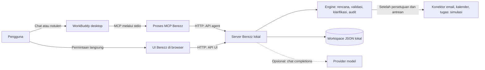

# Tech Stack dan Integrasi Berezz

Dokumen ini menjelaskan implementasi Berezz saat ini, cara komponen berkomunikasi, dan batas prototipe. Berezz dibuat untuk skenario **Challenge B — The Office Agent**: mengubah permintaan kerja menjadi rencana email, rapat, dan tugas yang ditinjau manusia.

## Gambaran sistem



WorkBuddy membantu menyusun usulan dan membaca status. Berezz memvalidasi usulan, menyajikan klarifikasi dan persetujuan, serta mencatat hasil. Berezz juga bisa digunakan langsung melalui UI tanpa WorkBuddy.

## Stack

| Bagian | Teknologi dan peran |
| --- | --- |
| Runtime | Node.js 18+ untuk server lokal dan proses MCP; `fetch` bawaan dipakai untuk HTTP keluar. |
| Bahasa | TypeScript untuk engine, pengolahan data, dan UI; server dan jembatan MCP berupa modul JavaScript `.mjs`. |
| Kompilasi | TypeScript 5.9, target ES2022, `strict: true`; kode `src/` dikompilasi ke `app/`. |
| Frontend | HTML, CSS, dan TypeScript DOM tanpa framework frontend; aset font Geist dan ikon Hugeicons tersedia secara lokal. |
| Backend | Server HTTP Node.js di `server.mjs`, menyajikan UI dan API untuk UI serta agent. |
| Penyimpanan | Berkas JSON lokal, default `data/workspace.json`; bukan database server. |
| Integrasi agent | Model Context Protocol (MCP) melalui stdio antara WorkBuddy dan `mcp/berezz-mcp.mjs`; jembatan memanggil API HTTP Berezz. |
| Planner model | Opsional, endpoint yang menyediakan API `/chat/completions` kompatibel OpenAI; terpisah dari model di WorkBuddy. |
| Suara | Browser Speech Recognition API bila didukung browser dan izin diberikan; ketersediaan bergantung pada browser dan lingkungannya. |
| Pengujian | `node:test`, pemeriksaan TypeScript, serta Playwright untuk skenario UI yang disiapkan proyek. |

## Alur kerja

1. Pengguna memasukkan teks atau lampiran di Berezz, atau meminta WorkBuddy membuat usulan melalui MCP.
2. Planner bawaan Berezz, model opsional, atau WorkBuddy menyusun rencana. Untuk usulan dari WorkBuddy, setiap aksi harus menyertakan kutipan sumber yang persis.
3. Engine memeriksa sumber, kontak, waktu, aturan kerja dan instruksi tersisip; informasi yang tidak jelas menjadi pertanyaan untuk manusia.
4. Reviewer membandingkan rencana dengan permintaan. Manusia memeriksa detail setiap aksi dan memberi persetujuan di UI Berezz.
5. Server memeriksa status dan kecocokan versi serta fingerprint. Aksi yang lolos masuk antrean dengan kesempatan urungkan 60 detik, lalu diteruskan ke konektor simulasi.
6. Permintaan, keputusan, dan hasil dicatat dalam audit job. Tidak ada email, undangan kalender, atau tugas eksternal sungguhan yang dibuat oleh konektor simulasi saat ini.

Rincian komponen, batas kepercayaan, dan trade-off: [architecture.md](architecture.md).

## Integrasi WorkBuddy

### Cara terhubung

1. Server Berezz harus menyala di komputer yang menjalankannya. Default-nya `http://localhost:8787`.
2. WorkBuddy menjalankan `mcp/berezz-mcp.mjs` sebagai proses lokal. Proses ini menerjemahkan panggilan MCP menjadi HTTP ke `/api/agent/*` Berezz.
3. Konfigurasi contoh ada di [`workbuddy.mcp.json`](../workbuddy.mcp.json). Jika direktori kerja WorkBuddy berbeda, gunakan path absolut untuk Node dan skrip MCP. `BEREZZ_URL` harus menunjuk ke server Berezz yang benar.
4. Pada WorkBuddy yang diuji di Mac ini, konektor kustom `berezz` telah tersambung dan menampilkan lima tool aktif. Dua folder skill planner dan reviewer tersedia di repositori; pemasangan keduanya di WorkBuddy belum dibuktikan pada pengujian tersebut.

Panduan konfigurasi lebih rinci: [workbuddy/README.md](../workbuddy/README.md). Konfigurasi MCP dapat berisi path yang berbeda di komputer lain.

### Tool yang tersedia

| Tool | Kegunaan |
| --- | --- |
| `berezz_create_job` | Membuat job dari permintaan dan menggunakan planner Berezz. |
| `berezz_propose_plan` | Mengirim rencana WorkBuddy dengan kutipan sumber untuk divalidasi Berezz. |
| `berezz_get_job` | Membaca status dan detail satu job. |
| `berezz_list_jobs` | Membaca daftar dan ringkasan job. |
| `berezz_find_contacts` | Mencari nama, peran, zona waktu, dan jenis kontak tanpa mengembalikan alamat email. |

API agent tidak menyediakan tool untuk menyetujui, mengubah, mengirim, atau membatalkan aksi. Persetujuan dilakukan manusia melalui UI Berezz. Ini adalah batas integrasi agent; bukan pengganti autentikasi pengguna untuk server produksi.

### Bukti uji saat ini

Pada uji manual dengan WorkBuddy, konektor terlihat aktif dan sebuah kasus fiktif membuat `JOB-0003`: tiga aksi terbentuk dan ketiganya meminta klarifikasi karena nama kontak tidak ditemukan. Pembacaan ulang melalui WorkBuddy menunjukkan kutipan sumber cocok. Uji tersebut **belum membuktikan** rangkaian jawaban klarifikasi, persetujuan, hasil simulasi, dan audit secara end-to-end melalui job yang sama. Kondisi workspace dapat berubah setelah pengujian tersebut.

## Integrasi data dan layanan lain

| Integrasi | Kondisi saat ini |
| --- | --- |
| Kontak, aturan, dan hari libur | Diimpor atau diatur di Berezz; proyek menyediakan dataset fiktif `datasets/organisasi-uji/dataset.json`. Itu bukan dataset resmi panitia. |
| Email, kalender, dan task board | Konektor simulasi; belum terhubung untuk melakukan perubahan pada layanan eksternal. |
| Model eksternal | Opsional pada server Berezz; memerlukan URL, kunci, dan nama model. Bila konfigurasi tidak lengkap, planner aturan bawaan yang digunakan. |
| Voice note | Input melalui kemampuan pengenalan suara browser jika tersedia; bukan layanan transkripsi server yang berdiri sendiri. |

## Menjalankan lokal

Di direktori proyek `beres`:

```bash
npm install
npm run build
npm start
```

Buka `http://localhost:8787`. Workspace baru kosong; untuk demo, impor dataset fiktif melalui halaman sumber data. Biarkan server berjalan selama UI dan konektor WorkBuddy digunakan. Server saat ini bind ke `127.0.0.1`, sehingga default-nya hanya dapat diakses dari mesin yang sama.

Pengaturan yang tersedia:

| Opsi / variabel | Fungsi |
| --- | --- |
| `--port` atau `BEREZZ_PORT` | Port server; default `8787`. |
| `--data` atau `BEREZZ_DATA` | Lokasi berkas workspace. |
| `BEREZZ_LLM_BASE_URL`, `BEREZZ_LLM_API_KEY`, `BEREZZ_LLM_MODEL` | Konfigurasi opsional planner model pada server. Jangan masukkan kunci ke repositori. |
| `BEREZZ_URL` | Alamat server yang dihubungi proses MCP; default `http://localhost:8787`. |
| `BEREZZ_TIMEOUT_MS` | Batas waktu HTTP proses MCP; default 30.000 ms. |

Pemeriksaan proyek:

```bash
npm run typecheck
npm run build
npm test
```

Perintah di atas adalah cara menjalankan pemeriksaan; dokumen ini tidak menyatakan bahwa tes tersebut dijalankan ulang saat dokumen ditulis. Bukti tes dan keterbatasannya: [test-results.md](test-results.md).

## Keamanan dan kesiapan deployment

- Workspace berisi JSON lokal tanpa enkripsi dan tanpa autentikasi akun. Gunakan data fiktif sampai perlindungan untuk data nyata tersedia.
- Perubahan melalui API UI memakai token per proses yang diberikan kepada halaman; ini bukan sistem login atau otorisasi multi-pengguna, dan tidak melindungi dari proses lain yang berjalan pada komputer yang sama.
- Server berjalan lokal dan menyimpan URL job berbasis `localhost`; hosting publik atau koneksi WorkBuddy jarak jauh **belum tersedia hanya dengan mengubah URL**.
- Untuk penggunaan bersama di cloud, perlu merancang dan menguji akses jaringan dan HTTPS, autentikasi serta otorisasi, penyimpanan bersama dan backup, keamanan data, serta penyesuaian URL dan integrasi MCP. Konektor nyata juga memerlukan integrasi dan pengujian terpisah.
- Belum ada bukti deployment publik atau integrasi layanan email/kalender/tugas sungguhan dalam implementasi yang didokumentasikan di sini.

## Berkas utama

| Lokasi | Isi |
| --- | --- |
| [`server.mjs`](../server.mjs) | Server HTTP, API, penyimpanan dan pengaturan planner model. |
| [`src/engine.ts`](../src/engine.ts) | Logika rencana, validasi, klarifikasi, persetujuan, antrean, dan audit. |
| [`src/dataset.ts`](../src/dataset.ts) | Impor dan normalisasi dataset organisasi. |
| [`src/ui.ts`](../src/ui.ts) | Antarmuka browser. |
| [`mcp/berezz-mcp.mjs`](../mcp/berezz-mcp.mjs) | Jembatan MCP ke API agent Berezz. |
| [`workbuddy/skills/`](../workbuddy/skills/) | Instruksi skill planner dan reviewer untuk WorkBuddy. |
| [`tests/`](../tests/) | Tes engine, dataset, MCP, dan penyimpanan. |
